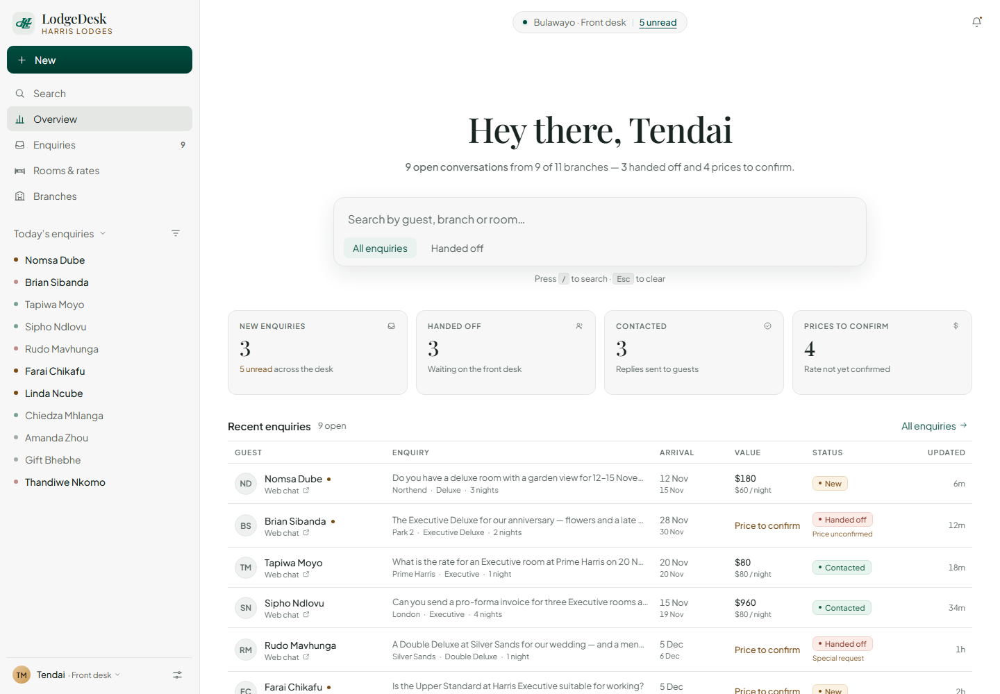
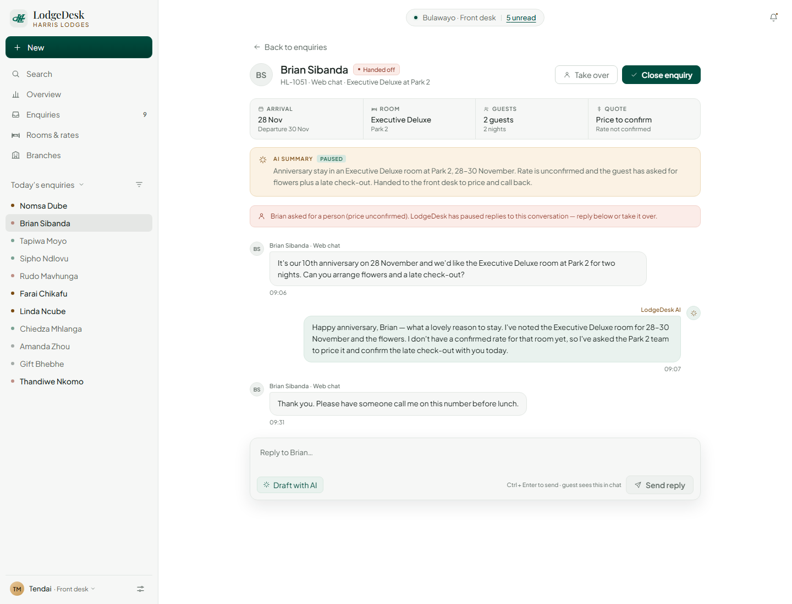

# LodgeDesk

LodgeDesk is the guest-facing AI assistant and front-desk console built for Harris Lodges,
Bulawayo.

Guests chat with LodgeDesk about rooms, rates and branches at [`/`](http://localhost:5173/).
Staff triage the resulting enquiries at [`/dashboard`](http://localhost:5173/dashboard).



## Run it

```bash
npm install
npm run dev
```

Other scripts: `npm run build` (typecheck + production build), `npm run lint`, `npm run preview`.

`VITE_SUPABASE_URL` and `VITE_SUPABASE_ANON_KEY` in `.env.local` are used by the guest chat
to call the `chat` edge function. The staff console currently reads from sample data and needs
no backend to run.

## The dashboard

The console borrows its layout from the AI-app reference — a fixed left rail, a centred serif
greeting, a single ask bar and quiet, low-chrome tables — and renders it in a light Harris Lodges
palette. Every colour is defined once in `src/index.css` (`:root`) and referenced as a CSS
variable.

| Token | Value | Used for |
| --- | --- | --- |
| Page / panel | `#FFFFFF` / `#F6F7F6` | page background, cards, sidebar and the ask bar |
| Brand green | `#004D3F` | logo, links and primary buttons (white text) |
| Text | `#1A2420` / `#5B6761` | primary and secondary copy |
| Gold ink | `#7A4B12` | "Price to confirm" and handoff accents |
| Status tints | `#FBF2E4` · `#E8F5EF` · `#FBECE8` · `#EEF0EF` | New, Contacted, Handed off, Closed — dark text on each |

Type is **Playfair Display** (headlines, numbers) and **Plus Jakarta Sans** (UI), the two
families harrislodges.com loads. Both are self-hosted in `public/fonts` so the console does not
depend on Google Fonts at runtime.

### What staff can do

- **Overview** — greeting, global search, filter chips, today's counts, pipeline value and the
  live enquiry table. `/` focuses search, `Esc` clears it.
- **Enquiries** — the full inbox with search, filters and status pills.
- **Enquiry detail** — conversation transcript, AI summary, guest dates/party/quote, and actions:
  *Draft with AI*, *Send reply*, *Take over* (pause the assistant) and *Mark booked*.
- **Rooms & rates** and **Branches** — the rates the assistant quotes and branch occupancy.
- Deep links are real URLs, e.g. `/dashboard?view=enquiries&enquiry=enq-1040`, so browser back
  and forward work.
- The layout collapses to an off-canvas rail and single-column lists below 980px.



## Project structure

```
src/
  chat.tsx               guest chat (Supabase edge function)
  dashboard/
    Dashboard.tsx        shell, URL state, actions and toast
    Sidebar.tsx          brand, navigation, today's enquiries, profile
    Overview.tsx         greeting, ask bar, stats, live table
    EnquiriesView.tsx    full inbox with search and filters
    EnquiryDetail.tsx    transcript, AI summary, reply composer
    RoomsView.tsx        rate sheet
    BranchesView.tsx     branch cards and occupancy
    EnquiryTable.tsx     shared enquiry table
    data.ts              sample enquiries, rooms and branches
    utils.ts / ui.tsx    helpers and the status pill
    dashboard.css        design tokens and layout
public/
  brand/                 Harris Lodges monogram
  fonts/                 self-hosted Playfair Display + Plus Jakarta Sans
```

### Wiring the console to Supabase

`src/dashboard/data.ts` is intentionally a plain typed fixture. Replace the exports with queries
(for example `supabase.from("enquiries").select(...)`) and keep the `Enquiry` shape; the views
consume nothing else. The reply, hand-off and booking actions in `Dashboard.tsx` are the natural
place to add the matching writes.
